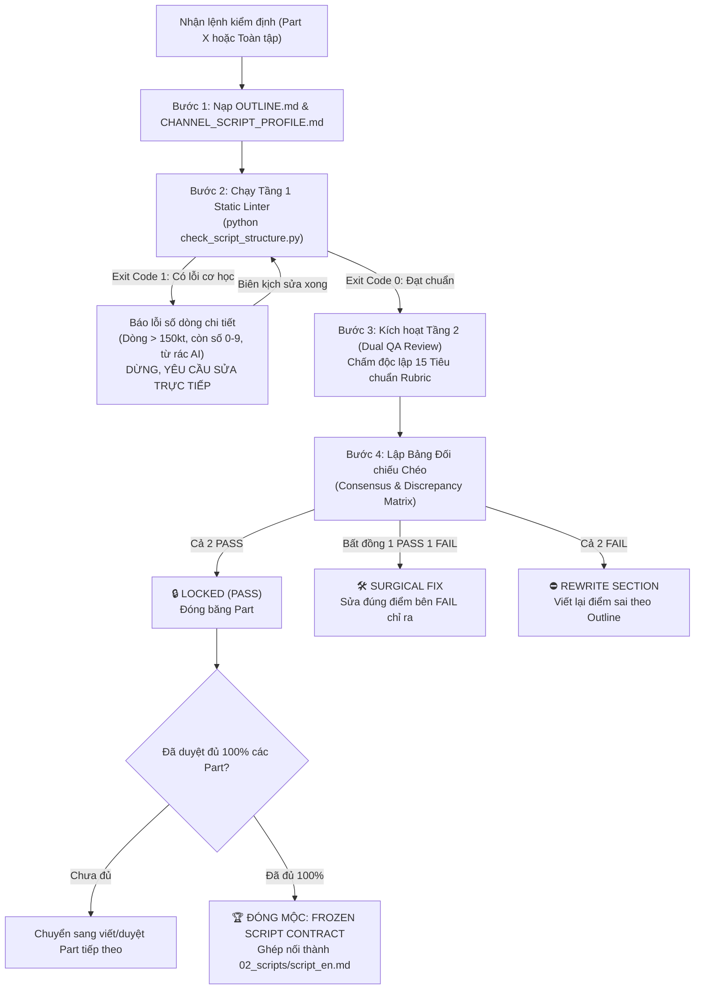

# Kỹ năng Kiểm định Kịch bản Chi tiết Đa kênh (Script Verifier Skill)

Kỹ năng này điều phối toàn bộ quy trình kiểm định kịch bản voice chia theo từng Hồi (`part-1.txt`, `part-2.txt`...) đặt tại thư mục `01_script/` của tập phim, tuân thủ nguyên tắc Single Source of Truth (SSOT) từ [UNIVERSAL_SCRIPT_VERIFICATION_PLAYBOOK.md](file:///g:/My%20Drive/YTB/projects/_shared/workflows/QUY_CHUAN_WORKFLOW_BIEN_SOAN_KICH_BAN/UNIVERSAL_SCRIPT_VERIFICATION_PLAYBOOK.md).

---

## 🏛️ NGUYÊN TẮC BẤT KHẢ XÂM PHẠM

1. **"Kẻ viết kịch bản không được tự chấm bài của mình."**
2. **Kiến trúc Hybrid 2 Tầng (Fail-Fast, Zero-Waste):**
   * **Tầng 1 (Python Static Linter - 0 Token, < 0.2s):** Bắt buộc chạy script kiểm tra cơ học trước. Nếu Exit Code 1 $\rightarrow$ **DỪNG NGAY LẬP TỨC**, báo rõ số dòng lỗi để biên kịch sửa tại chỗ, **TUYỆT ĐỐI KHÔNG GỌI LLM TẦNG 2**.
   * **Tầng 2 (Dual QA Double-Blind Review - 15 Tiêu chuẩn):** Chỉ kích hoạt khi Tầng 1 đạt Exit Code 0. Chấm điểm độc lập, không xem bài của nhau.
3. **Cơ chế Trọng tài Đối chiếu Chéo:**
   * Cả 2 cùng PASS (15/15) $\rightarrow$ 🔒 `LOCKED (PASS)` (Đóng băng Part, chuyển sang Part kế tiếp).
   * Bất đồng (1 PASS, 1 FAIL) $\rightarrow$ Áp dụng luật *"Thà bắt nhầm còn hơn bỏ sót"*, tự động đứng về bên FAIL $\rightarrow$ `🛠️ SURGICAL FIX` (Chỉ định sửa đúng dòng vi phạm trong `part-X.txt`).
   * Cả 2 cùng FAIL $\rightarrow$ `⛔ REWRITE SECTION` (Xóa và viết lại mới hoàn toàn đoạn sai theo `OUTLINE.md`).

---

## ⚡ 2 CHẾ ĐỘ VẬN HÀNH CHÍNH

### Chế độ 1: Kiểm định Cuốn chiếu Từng Part (`Surgical Part Check` - Khuyên dùng trong lúc viết)
Áp dụng khi vừa hoàn thành hoặc sửa đổi một tệp Hồi (ví dụ: `part-1.txt` hoặc `part-2.txt`).

### Chế độ 2: Nghiệm thu Tổng thể Toàn tập (`Full Episode Batch Check`)
Áp dụng khi đã có đủ 100% các tệp Part trong `01_script/` để đóng mộc `FROZEN SCRIPT CONTRACT (PRODUCTION READY)`.

---

## 🛠️ QUY TRÌNH THỰC THI CHI TIẾT (STEP-BY-STEP)



### Bước 1: Nạp Ngữ Cảnh Kiểm Định
1. Đọc tệp `OUTLINE.md` đã phê duyệt của tập phim để lấy:
   * Số lượng Hồi và cấu trúc từng Part.
   * Ngân sách số từ của từng Hồi (`~X từ`).
   * Bảng thuật ngữ chuyên ngành `[Term]`.
   * Mốc thời gian `Save Trigger` (nếu có).
2. Đọc tệp `00_CHANNEL/CHANNEL_SCRIPT_PROFILE.md` (hoặc `SCRIPT_GUIDE.md` & `VOICE_CONFIG.md`) của kênh để lấy:
   * Persona người kể chuyện (sắc lạnh, mỉa mai, cổ sinh vật hay chiến thuật).
   * Tốc độ đọc WPM thực nghiệm chuẩn.
   * Danh mục nguồn dữ liệu thẩm quyền (SEC 10-K, Nature, Opta...).

### Bước 2: Chạy Tầng 1 — Static Python Linter (Bắt buộc)
Chạy script Python offline để rà soát lỗi cơ học trong `< 0.2` giây:

* **Đối với 1 Part:**
  ```powershell
  python "d:\youtube\Video\Workspace_YTB\.agents\skills\script-verifier\scripts\check_script_structure.py" --part "[ĐƯỜNG_DẪN_PART-X.txt]" --outline "[ĐƯỜNG_DẪN_OUTLINE.md]"
  ```
* **Đối với toàn bộ thư mục tập phim:**
  ```powershell
  python "d:\youtube\Video\Workspace_YTB\.agents\skills\script-verifier\scripts\check_script_structure.py" "[ĐƯỜNG_DẪN_THƯ_MỤC_TẬP]"
  ```

**Xử lý kết quả Tầng 1:**
* Nếu `Exit Code 1`: Báo cáo danh sách dòng bị lỗi (dòng $> 150$ kt, còn chữ số `0-9`, ký hiệu `$`, `%`, từ rác AI, lệch ngân sách từ $> \pm 10\%$). **Yêu cầu sửa ngay trong file text và chạy lại Bước 2.**
* Nếu `Exit Code 0`: Tự động chuyển tiếp sang Bước 3.

### Bước 3: Thẩm định Tầng 2 — Dual QA Review (15 Tiêu chuẩn Master Rubric)
Đọc tài liệu tham chiếu [master_rubric_15.md](file:///d:/youtube/Video/Workspace_YTB/.agents/skills/script-verifier/references/master_rubric_15.md) và thực hiện 2 lượt chấm điểm độc lập (QA 1 và QA 2) trên tệp kịch bản:

* **Nhóm 1 (Âm học & Văn nói):**
  * `S-01`: Khí chất Persona & Đúng vị thế đồng minh, cấm giọng giảng bài giáo điều.
  * `S-02`: Nhịp thở văn nói & Single-Breath Unit (< 20 từ/vế câu, cấm dấu gạch ngang `—`).
* **Nhóm 2 (Giữ chân & SEO YouTube):**
  * `S-03`: Mỏ neo 0:00 & Spoken SEO lặp 2 lần/30s đầu (*Chỉ áp dụng Part 1*).
  * `S-04`: Cú sốc nhận thức 30–45s đầu đập vỡ niềm tin cũ (*Chỉ áp dụng Part 1*).
  * `S-05`: Curiosity Bridges & Rehook cuối mỗi Part.
  * `S-06`: Lời thoại Save Trigger đúng mốc vàng (*Part có quy định trong Outline*).
  * `S-07`: Kéo kiến thức về điểm chạm sát sườn người xem / ví tiền.
  * `S-08`: Cold Punchline kết bài dứt khoát (*Chỉ áp dụng Part cuối*).
* **Nhóm 3 (Dữ liệu định lượng & Thuật ngữ):**
  * `S-09`: Bóc tách số liệu đối chiếu nguồn thẩm quyền, cấm bịa số.
  * `S-10`: Ẩn dụ đời thường & Bảo toàn 100% thuật ngữ `[Term]`.
* **Nhóm 4 (Hạ tầng TTS & Đa Part):**
  * `S-11`: Độ dài dòng thoại mục tiêu < 115 kt (tối đa <= 150 kt) & Ngân sách từ Part ±10%.
  * `S-12`: Chuẩn hóa văn bản TTS 100% (0 số, 0 markdown, 0 thẻ nhãn lạ).
  * `S-13`: Đầy đủ số Part theo Outline, ranh giới Hồi mượt mà.
* **Nhóm 5 (Khử rác AI & Mật độ thông tin):**
  * `S-14`: Sạch 100% từ rác AI tiếng Anh & tiếng Việt.
  * `S-15`: Triệt tiêu cấu trúc nhị phân ("Not because X, but Y") & Mật độ thông tin cao.

### Bước 4: Lập Bảng Đối Chiếu Chéo & Xuất Báo Cáo
Ghi hoặc cập nhật kết quả vào tệp `SCRIPT_AUDIT_REPORT.md` (nằm cùng cấp với `OUTLINE.md` hoặc trong `01_script/`) dựa trên biểu mẫu chuẩn [audit_report_template.md](file:///d:/youtube/Video/Workspace_YTB/.agents/skills/script-verifier/references/audit_report_template.md):
1. **Phán quyết Part:**
   * `🔒 LOCKED (PASS)`: Nếu 2/2 QA đều PASS cả 15 tiêu chuẩn.
   * `🛠️ SURGICAL FIX`: Nếu có bất đồng (1 PASS, 1 FAIL) $\rightarrow$ Chỉ rõ tên file, mã tiêu chuẩn và số dòng cần tinh chỉnh theo bên FAIL.
   * `⛔ REWRITE SECTION`: Nếu 2/2 QA cùng FAIL $\rightarrow$ Xóa và viết lại đoạn sai theo Outline.
2. **Ký Hợp Đồng Toàn Tập (`Frozen Script Contract`):**
   * Khi 100% các Part (từ Part 1 đến Part N) đều đạt mộc `LOCKED (PASS)`:
   * Đóng dấu chung cuộc: **`STATUS: FROZEN SCRIPT CONTRACT (PRODUCTION READY)`** 🔒.
   * Ghép nối tuần tự các tệp `part-1.txt` đến `part-N.txt` thành tệp kịch bản hoàn chỉnh `02_scripts/script_en.md`.

---

## 💬 MẪU LỆNH KÍCH HOẠT NHANH TRONG CHAT

Khi cần verify kịch bản, người dùng chỉ cần gõ:

* **Verify 1 Part:**
  > *"Verify part 1 cho vid_01"* hoặc *"/verify-part part-1.txt"*
* **Verify toàn bộ kịch bản tập phim:**
  > *"Verify kịch bản cho vid_01"* hoặc *"/verify-script 02_PRODUCTION/vid_01"*
